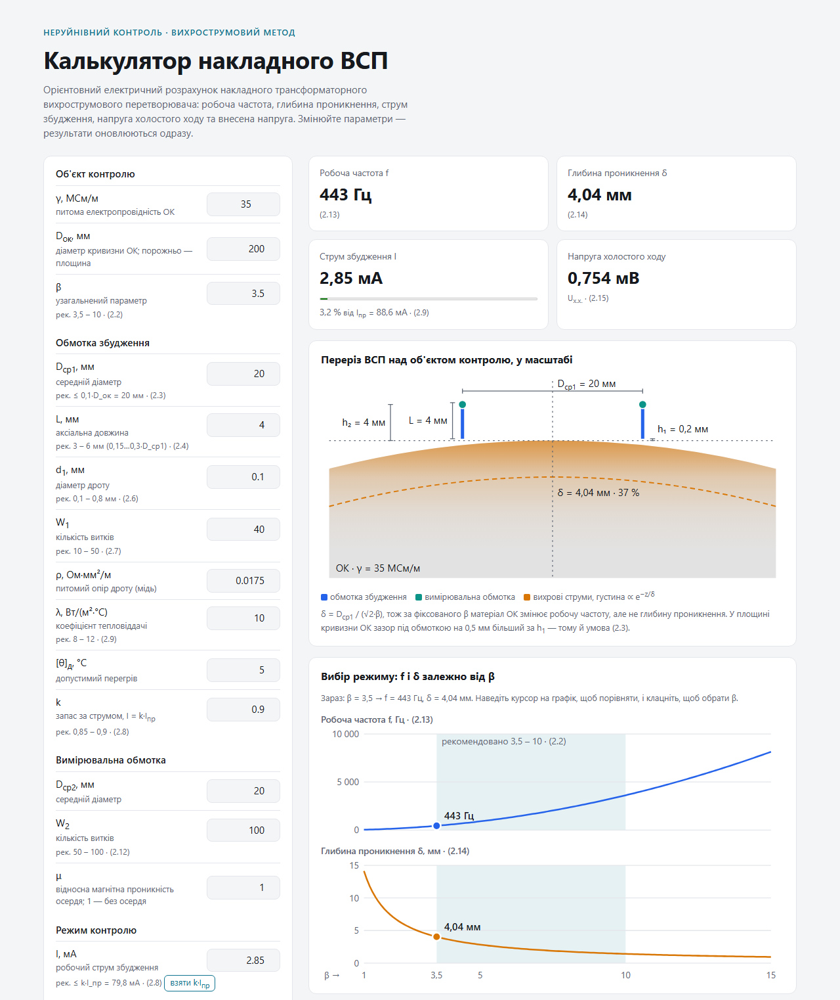

# Surface eddy-current probe calculator

[](https://github.com/lev-oxr/eddy-current-probe-calc/actions/workflows/pages.yml)
**[Open the calculator](https://lev-oxr.github.io/eddy-current-probe-calc/)** · [Українська](README.md)

An online calculator for the electrical design of a surface transformer-type eddy-current probe.
It computes the operating frequency, penetration depth, excitation current, open-circuit voltage,
induced and output voltage, and the requirements for the measurement channel.
Results update as soon as any parameter changes. The interface is in Ukrainian.

The method follows section 2.2 of O. E. Levchenko's master's thesis "Automation of eddy-current flaw
detection of objects with complex surface geometry" (Igor Sikorsky Kyiv Polytechnic Institute,
Department of Instruments and Systems for Non-Destructive Testing, 2018).



## Features

- calculation by formulas (2.3)–(2.20) with a step-by-step table that keeps the thesis formula numbers;
- analytic relative induced voltage U\*ind instead of reading it off a locus chart;
- live impedance-plane locus (fig. 2.6): operating point, lift-off and conductivity loci, and the angle between them;
- to-scale probe cross-section over the test object, showing the eddy-current penetration depth;
- f(β) and δ(β) plots with the recommended 3.5–10 zone;
- output voltage phasor diagram;
- measurement channel: gain, quantisation, sampling, maximum scanning speed;
- highlighting of parameters outside the recommended ranges.

## Model and verification

Relative induced voltage of two thin coaxial turns of radius R above a non-magnetic conducting half-space
(Dodd–Deeds model), normalised as the locus in fig. 2.6:

```
U*ind = jπ ∫₀^∞ J₁²(x) · e^(−x·h*) · (x − q)/(x + q) dx,   q = √(x² + jβ²),   h* = (h₁ + h₂)/R
```

`npm test` checks:

- formulas (2.3)–(2.20) against the source data of section 2.2;
- U\*ind as β → ∞ against the closed form −Q₁/₂(1 + h\*²/2) (0.2 % accuracy) and against the points of fig. 2.6;
- the measurement-channel block against a hand calculation.

Model limits (non-magnetic homogeneous test object, thin turns, the method's empirical factors, engineering
rules for the channel) are described on the page in the "About the model and its limits" section.
The result is an estimate and does not replace a certified inspection procedure.

## Files

| File | Contents |
|---|---|
| `index.html` | page markup: form, cards, tables |
| `style.css` | styles, light and dark themes |
| `app.js` | UI: reading the form, plots, range hints |
| `calc.js` | calculation: `calcVSP` (section 2.2 formulas), `ustar` (U\*ind), `calcChannel` (measurement channel) |
| `calc.test.js` | calculation checks |
| `package.json` | the `npm test` command |
| `screenshot.png` | README screenshot |
| `.github/workflows/pages.yml` | test and publish to GitHub Pages on push to `main` |

## Running

No build step or dependencies. Open `index.html` in a browser or start a local server:

```bash
python -m http.server 8000
```

Calculation checks (requires Node.js):

```bash
npm test
```

## License

[MIT](LICENSE)
